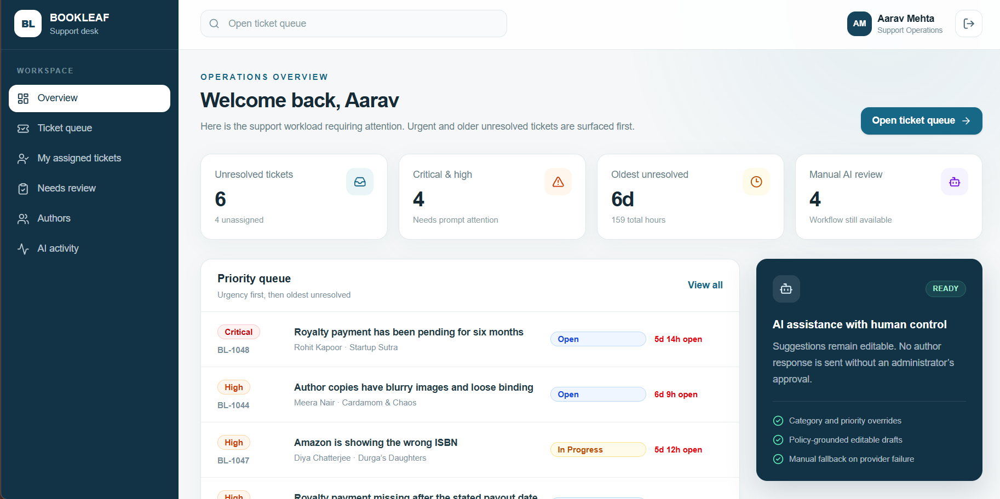
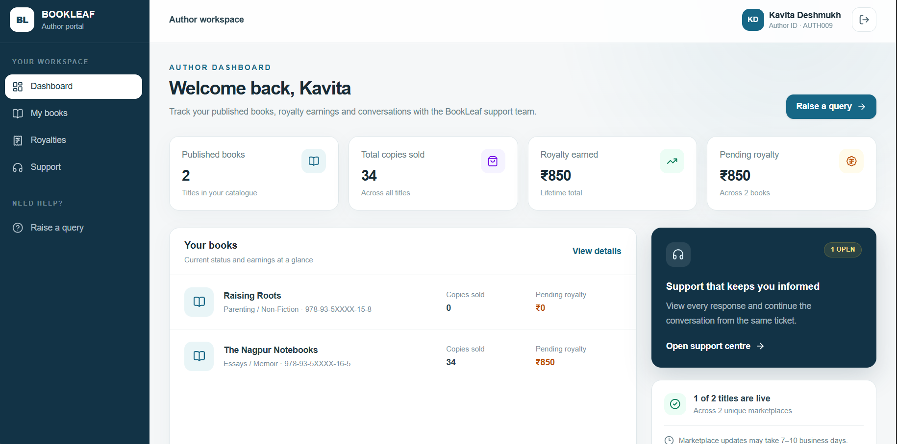

# BookLeaf Author Support & Communication Portal

Full-stack technical assignment for BookLeaf Publishing. The application contains an operations-focused admin workspace, an author portal, a provider-neutral AI layer, and a secure Supabase/PostgreSQL data model.

**Live demo:** [BookLeaf Portal](https://bookleaf-portal-wine.vercel.app/) · **Source:** [GitHub](https://github.com/Shashu-1234/bookleaf-portal) · **Approach:** [one-page write-up](docs/approach.md) · **API:** [OpenAPI](https://bookleaf-portal-wine.vercel.app/api/v1/openapi.json)

The priorities are grounded AI assistance, maintainable architecture, explicit authorization and a complete human-reviewed ticket flow. This guide explains both what is implemented and the boundaries of the demonstration.

## Contents

- [Reviewer walkthrough](#reviewer-walkthrough)
- [Hosted demo accounts](#hosted-demo-accounts)
- [Local setup](#local-setup)
- [Database workflow](#database-workflow)
- [Architecture and decisions](#architecture-and-decisions)
- [AI integration](#ai-integration)
- [Quality checks](#quality-checks)
- [REST API](#rest-api)
- [Known limitations and assumptions](#known-limitations-and-assumptions)
- [Production evolution](#production-evolution)
- [Submission documentation](#submission-documentation)

## Current implementation

### Dashboard previews

Admin dashboard: support workload, priority queue and operations navigation.



Author dashboard: Kavita's catalogue, royalty balances and support overview.



These screenshots capture the synthetic demo at a point in time; live counts and statuses may change.

### Features

- Admin overview, ticket queue, filtering, assignment, internal notes, AI review and editable response drafts
- Author dashboard, books, marketplace availability, royalties, support history and query submission flow
- Provider-neutral AI architecture: Gemini, Ollama, or typed manual fallback
- Supabase PostgreSQL schema with Row Level Security, Realtime and generated TypeScript types
- Assignment dataset seeded idempotently: 10 authors and 18 books
- Responsive Next.js 16 application deployed on Vercel
- Email/password authentication with verified server sessions and role-aware routing
- Database-backed author queries, replies, admin overrides, assignments, notes and responses
- Versioned REST API with bearer/cookie authentication, RBAC, Zod validation and consistent errors

All portal reads and operational mutations are backed by Supabase. The remaining mock-data files are isolated fixtures for deterministic UI-model tests and are not imported by production routes.

## Hosted demo accounts

### Reviewer walkthrough

1. Open the live application and sign in as Rohit using the author credentials below. Inspect books, royalties and support history.
2. Submit a query for a specific book or General / Account Level, with a subject and description. The ticket is saved before AI processing.
3. In another browser profile or private window, sign in as the administrator. Find the ticket in the queue; inspect category, priority, draft and AI review state. In manual mode, write a response directly.
4. Override category/priority, assign the ticket to yourself, add an internal note, edit/send a public response, and change the status.
5. Return to the author's ticket. Realtime subscriptions refresh ticket/conversation data without a manual reload. A 15-second polling fallback runs on visible author dashboard/support pages when no refresh is pending; returning to the tab also refreshes. Verify that internal notes remain private.
6. Use Sneha and Kavita to inspect both production titles, zero royalties and pending balances. Try an empty queue filter and paginated conversations.

Use synthetic queries: this is a shared environment and tickets persist. File attachment selection is UI-only; uploads are not implemented. Model drafts require an explicit administrator send action.

The hosted project uses synthetic assignment-only identities:

| Workspace | Email | Password |
| --- | --- | --- |
| Support operations | `admin@bookleaf.example` | `BookLeaf!Admin2026` |
| Author (Priya Sharma) | `priya@bookleaf.example` | `BookLeaf!Priya2026` |
| Author (Rohit Kapoor) | `author@bookleaf.example` | `BookLeaf!Author2026` |
| Author (Ananya Reddy) | `ananya@bookleaf.example` | `BookLeaf!Ananya2026` |
| Author (Vikram Joshi) | `vikram@bookleaf.example` | `BookLeaf!Vikram2026` |
| Author (Meera Nair) | `meera@bookleaf.example` | `BookLeaf!Meera2026` |
| Author (Arjun Malhotra) | `arjun@bookleaf.example` | `BookLeaf!Arjun2026` |
| Author (Sneha Kulkarni — production and zero-royalty titles) | `sneha@bookleaf.example` | `BookLeaf!Sneha2026` |
| Author (Farhan Sheikh) | `farhan@bookleaf.example` | `BookLeaf!Farhan2026` |
| Author (Kavita Deshmukh — production title and pending payout) | `kavita@bookleaf.example` | `BookLeaf!Kavita2026` |
| Author (Diya Chatterjee) | `diya@bookleaf.example` | `BookLeaf!Diya2026` |

These credentials contain no real personal data and must be replaced before any production use.

All ten supplied authors have isolated login accounts. The Sneha and Kavita accounts make the dataset's production, zero-royalty, no-payout and pending-payout edge cases directly reviewable through the author portal.

## Technology

- Next.js 16, React 19 and TypeScript
- Tailwind CSS 4
- Supabase PostgreSQL, Auth and Realtime
- Zod validation
- Vitest and ESLint
- Vercel deployment

## Local setup

Prerequisites: Node.js 22, npm, Git and a Supabase project. Docker is also required for a fully local Supabase stack. An LLM key is optional in manual mode.

```bash
git clone https://github.com/Shashu-1234/bookleaf-portal.git
cd bookleaf-portal
npm ci
copy .env.example .env.local
npm run dev
```

`copy` is for Windows; use `cp .env.example .env.local` on macOS/Linux. Fill in the configuration before starting the app. Open <http://localhost:3000>. A private clone requires approved GitHub access.

Configure these public Supabase values in `.env.local`:

```dotenv
NEXT_PUBLIC_SUPABASE_URL=
NEXT_PUBLIC_SUPABASE_PUBLISHABLE_KEY=
```

The publishable key is designed for browser use. Authorization is enforced by PostgreSQL Row Level Security. Never expose a Supabase secret or service-role key through a `NEXT_PUBLIC_` variable.

### Environment reference

| Variable | Purpose | Required |
| --- | --- | --- |
| `NEXT_PUBLIC_SUPABASE_URL` | Supabase API URL | Yes |
| `NEXT_PUBLIC_SUPABASE_PUBLISHABLE_KEY` | Browser-safe project key | Yes |
| `SUPABASE_SECRET_KEY` | Server-only trusted AI context/audit operations | For background AI workflow |
| `AI_PROVIDER` | `manual`, `gemini`, or `ollama`; default `manual` | Optional |
| `GEMINI_API_KEY` | Server-only Gemini credential | For Gemini |
| `GEMINI_MODEL` | Model identifier; see `.env.example` | Configurable; code has a default |
| `OLLAMA_BASE_URL` | Default `http://127.0.0.1:11434` | For Ollama |
| `OLLAMA_MODEL` | Installed model; default `gpt-oss` | For Ollama |
| `AI_TIMEOUT_MS` | Default `15000`; bounded to 1000–60000 | Optional |
| `AI_MAX_ATTEMPTS` | Default `2`; bounded to 1–3 | Optional |

### Choose a database

For a fully local database, start Docker and run:

```bash
npx supabase start
npx supabase db reset
npx supabase status
```

Reset recreates the disposable local database and applies committed migrations and `supabase/seed.sql`. Use the local API URL and keys from Supabase in `.env.local`. Keep secret values private. Hosted demo passwords do not automatically work against a new database.

For your own hosted project:

```bash
npx supabase login
npx supabase link --project-ref YOUR_PROJECT_REF
npx supabase db push
```

Apply `supabase/seed.sql` through your project's SQL editor after migrations. Obtain project URL/keys from its settings. Set the Auth site URL to localhost and add the deployed origin when hosting. Do not reset or seed an existing database containing real data.

### Provision login identities

The publishing seed does not create Supabase Auth passwords. Create confirmed email/password users through your project's Auth admin interface or local Studio. Using a trusted Auth Admin operation, set `app_metadata.role` to `author`, `admin`, or `ops`. User-editable metadata is not a role source. Sign out and back in after changing role claims.

Link each author Auth UUID to its dataset record; create staff profiles for admin/ops users. Replace the illustrative UUIDs below before running against your own database:

```sql
-- AUTH002 is Rohit Kapoor; repeat for AUTH001–AUTH010 as needed.
update public.authors
set user_id = 'AUTHOR_AUTH_USER_UUID'::uuid
where id = 'AUTH002';

-- Also set app_metadata.role = admin through Auth Admin.
insert into public.staff_profiles (user_id, display_name, email)
values ('ADMIN_AUTH_USER_UUID'::uuid, 'Demo Administrator', 'admin@bookleaf.example');
```

Auth login aliases may differ from the original dataset emails. The publishing seed preserves the supplied records. Never assign roles from untrusted browser input.

## Database workflow

```bash
# Regenerate deterministic seed SQL from the assignment JSON
npm run db:seed:generate

# Start/reset locally when Docker is available
npx supabase start
npx supabase db reset

# Run RLS tests and database linting
npx supabase test db
npm run db:validate
```

Schema changes are stored in `supabase/migrations/`; assignment data is stored in `supabase/seed.sql`. See [Database architecture](docs/database-architecture.md) and [AI architecture](docs/ai-architecture.md).

The committed seed works without the original JSON. To regenerate on another machine, run `node scripts/generate-supabase-seed.mjs /path/to/bookleaf_sample_data.json`; the npm shortcut uses the original Windows path. Upserts preserve stable business IDs without creating duplicate authors/books. Book-level royalty totals are distinct from payout history: an empty transfer list does not imply a zero pending balance.

## Architecture and decisions

```text
src/app/                 Pages, loading boundaries and /api/v1 routes
src/features/author/     Author presentation and view models
src/features/admin/      Operations presentation and queue models
src/lib/api/             Auth wrapper, validation, contracts and errors
src/lib/database/        Repositories and trusted AI persistence
src/lib/ai/              Prompts, knowledge base, workflow and providers
src/lib/supabase/        Browser/server clients and generated types
supabase/                Migrations, seed and policy tests
docs/                    API, architecture, limitations and approach
```

| Decision | Reason and trade-off |
| --- | --- |
| Next.js/TypeScript modular application | One deployable service with typed boundaries keeps assignment setup practical. |
| PostgreSQL with Auth/RLS | Relationships fit authors/books/tickets; ownership is enforced independently of UI checks. |
| REST mutations and in-process server reads | Browser operations have documented contracts; Server Components avoid calling their own backend over HTTP. Not every page read uses REST. |
| Separate messages, notes and AI audits | Public conversation, private operational context and AI evidence have distinct access requirements. |
| Provider adapters and manual fallback | Vendor SDK details stay outside workflows, and support remains usable during provider failure. |
| Realtime and pagination | Responsive updates with bounded collection queries. |
| Screen-specific projections and per-render auth caching | Smaller payloads and fewer duplicate session checks without cross-user session caching. |
| Mumbai application/database execution | Reduces server-to-database distance; end-user latency still depends on network conditions. |

Server-validated claims protect application routes and API handlers. Trusted app metadata controls staff access; RLS enforces author ownership. Internal notes and AI drafts are not author-visible. The server-only trusted background AI client is separate from the RLS-scoped client used by ordinary REST handlers. See [database architecture](docs/database-architecture.md) for relationships and policy details.

## AI integration

### Model choice

Gemini offers an API-backed option for low-cost experimentation. Ollama supports local inference and runtime control, with hardware/setup trade-offs. The provider-neutral service makes either replaceable. Provider terms, quotas and model availability must be checked when enabling a deployment; no permanent free quota is assumed. Configure an available model through the environment rather than changing domain code.

Gemini requires `AI_PROVIDER=gemini`, `GEMINI_API_KEY`, `GEMINI_MODEL` and the trusted Supabase secret. Ollama requires a running service with the selected model and `AI_PROVIDER=ollama`; configure its base URL/model as needed. A Vercel function cannot reach your laptop's Ollama service through `localhost`.

### Prompts and execution

1. Persist the ticket, then schedule post-response analysis using trusted author/book context.
2. Request structured category, Critical/High/Medium/Low priority, confidence and rationale.
3. Draft with shared company/tone/accuracy instructions and the relevant category policy.
4. Independently validate provider JSON with Zod and persist audit evidence and an editable draft.
5. Let staff override classification/priority, review/edit the draft and explicitly send the response. Regeneration creates a separate audit record.

Required categories: Royalty & Payments; ISBN & Metadata Issues; Printing & Quality; Distribution & Availability; Book Status & Production Updates; General Inquiry.

Policy context includes the 80/20 net-profit split, quarterly/45-day payout cycle, ₹1,000 rollover threshold, ISBN escalation, verified free reprints, listing/resync windows and production stages. Prompts treat author text as untrusted, require empathetic BookLeaf communication and forbid fabricated dates, platform sales, production progress or completed actions. Inspect `src/lib/ai/knowledge-base.ts`, `prompts.ts` and `schemas.ts` for implementation.

### Error handling, cost and privacy

Missing keys, rate limits, timeouts, outages and malformed output return typed manual-review outcomes. Failure does not undo ticket creation, and staff can respond manually. Failed regeneration preserves a previous usable draft. Audit records store safe failure information rather than exposing raw provider errors or secrets.

Analysis output is capped at 700 tokens and drafts at 1,200. Draft calls receive category-scoped policy; attempts and timeouts are bounded. Provider/model, timing and token usage are auditable. Regeneration can consume more usage; a hard spending cap and per-user quotas remain production improvements.

Use synthetic data for this demonstration. Provider data-use terms depend on the selected tier. Real author data requires reviewed retention/privacy settings, an appropriate commercial arrangement or controlled self-hosting. Credentials remain in server environment variables.

**Execution evidence:** code is connected, but the repository default is manual mode. The latest documentation review did not prove a successful hosted model call. Verify deployment configuration and an actual successful `ai_runs` record before claiming live AI execution. Manual fallback is not evidence of a model response.

## Quality checks

```bash
npm run typecheck
npm test
npm run lint
npm run build
npm audit
```

Latest implementation checks passed: ESLint, TypeScript/production build and 25 tests across seven files. Coverage includes AI service/fallback behavior, workflow audit construction, API contracts, pagination, queue models and query projections. Authenticated read checks across ten hosted identities confirmed one visible author profile each and eighteen books in total; that does not independently verify every browser route or role claim. Database tests/lint need the local stack. `npm audit` is an inspection command, not an assertion of zero advisories.

For release review, also exercise public response delivery, note privacy, role claims and a configured provider's success/failure paths. Documentation-only edits receive link and whitespace checks rather than another full build.

## Routes

- `/admin` — operations overview
- `/login` — role-aware email/password sign-in
- `/admin/tickets` — support queue
- `/admin/tickets/[ticketId]` — ticket workspace
- `/admin/assigned` — tickets assigned to the signed-in staff account
- `/admin/review` — unresolved tickets whose latest AI attempt needs manual review, or has not run
- `/admin/authors` — searchable publishing directory, book statuses and royalty totals with author-scoped ticket links
- `/admin/ai-activity` — paginated AI audit records, model/token/latency metadata and safe failure codes
- `/author` — author overview
- `/author/books` — catalogue and distribution
- `/author/royalties` — earnings and payouts
- `/author/support` — author support centre
- `/author/support/new` — query submission

## REST API

The versioned API is rooted at `/api/v1`; its OpenAPI 3.1 document is served at [`/api/v1/openapi.json`](https://bookleaf-portal-wine.vercel.app/api/v1/openapi.json). See [API documentation](docs/api.md) for authentication, role permissions, endpoint contracts, pagination, response envelopes and curl examples.

Browser mutations use the REST API through the existing secure session cookie. Postman and other external clients can use a Supabase access token with `Authorization: Bearer <token>`. The API middleware validates trusted `app_metadata` roles, while PostgreSQL RLS independently enforces row ownership.

## Deployment

Production: <https://bookleaf-portal-wine.vercel.app>

AI is disabled by default (`AI_PROVIDER=manual`), so local development and database work cannot incur provider usage accidentally.

Deploy this repository as a Next.js project with the committed lockfile. Configure the environment variables in the hosting dashboard, including server-only secrets for AI processing. Add the deployed origin to Supabase Auth settings and keep application execution near the database. Recheck login, role routing, RLS, ticket creation, Realtime and provider configuration after deployment. Changing environment variables requires a new deployment to take effect.

## Known limitations and assumptions

The Needs review view scans minimal unresolved-ticket/latest-run projections before filtering and paginating full tickets. This keeps the current small dataset simple; at production scale, move latest-run filtering/counting into an indexed database query to avoid growing candidate scans and ID filters. These admin pages are read-only until a staff member explicitly opens a ticket and performs an existing action; opening AI activity does not request model inference.

- Hosted AI success requires separate verification; enabled workflow code does not prove provider availability or quality.
- Initial AI work uses Next.js post-response execution, not a durable queue; interrupted jobs need a production recovery mechanism.
- Publishing/sales/royalty values are synthetic seed data. There are no live marketplace, bank-transfer or production-tracking integrations, and no fabricated per-platform financial breakdown.
- File attachments are UI-only, as permitted by the brief. Downloadable statements are not implemented.
- Shared demo passwords are for evaluation only. Fresh databases need Auth users, trusted role claims and profile links provisioned separately.
- Schema/prompt controls do not guarantee model correctness. Human approval remains required; a labelled AI benchmark, load tests and comprehensive browser end-to-end tests remain future work.
- An empty payout history and zero earnings are valid data states. Pending balances are informational, not proof that a bank transfer has been scheduled.

Assumptions: the supplied dataset and knowledge base are authoritative for this demonstration; no model suggestion authorizes a financial transaction or automatic public reply. See [full limitations](docs/limitations.md).

## Production evolution

1. Replace post-response AI work with durable, idempotent jobs, bounded retries and recovery for interrupted processing.
2. Add labelled classification/priority/grounding evaluations, injection tests and monitoring of draft acceptance and human overrides.
3. Add usage quotas, spending alerts, latency/error dashboards and a reviewed provider privacy/retention configuration.
4. Replace shared demo accounts with managed provisioning and recovery; test backups/restores and expand browser/security/load coverage with release gates.
5. Integrate authoritative publishing/accounting systems before exposing live balances, transfer actions or platform breakdowns.

The [one-page approach](docs/approach.md) summarises priorities, trade-offs and this evolution separately, as requested by BookLeaf.

## Submission documentation

- [One-page approach and production evolution (PDF)](docs/bookleaf-approach.pdf) · [Markdown source](docs/approach.md)
- [Known limitations and assumptions](docs/limitations.md)
- [REST API contracts and examples](docs/api.md)
- [AI architecture, configuration and reliability](docs/ai-architecture.md)
- [Database architecture and ownership](docs/database-architecture.md)

The AI workflow is connected in application code. The default manual configuration is distinct from verified hosted provider execution; no successful live AI run is asserted by this README. See the limitations for the evidence boundary.

Repository: <https://github.com/Shashu-1234/bookleaf-portal>. BookLeaf supplied `musavir@bookleafpub.in` for collaborator access if the repository stays private; invitation acceptance must be confirmed before handover.
