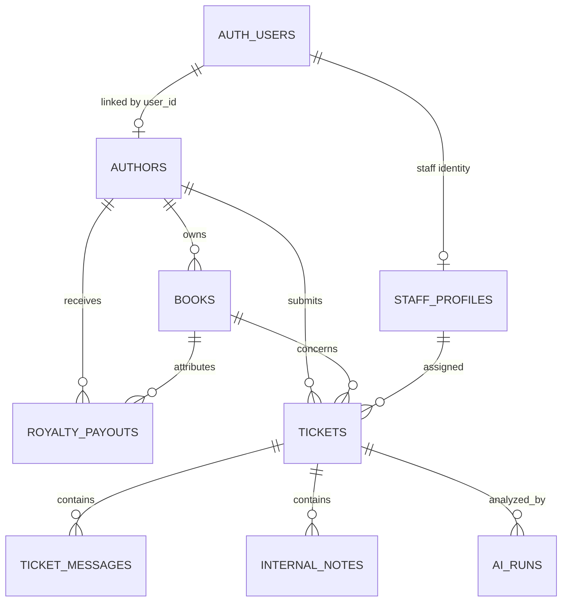

# Database architecture

## Design goals

The database separates publishing records, support operations and AI audit data while enforcing authorization in PostgreSQL—not only in the UI. The browser receives only a Supabase publishable key; every exposed table has RLS enabled and explicit grants.

## Authorization model

| Resource | Author | Admin / Ops | Anonymous |
|---|---|---|---|
| Author profile | Own record | All | None |
| Books and royalties | Own records | All | None |
| Tickets | Own records; create | All; update | None |
| Ticket messages | Own tickets; reply | All; reply | None |
| Internal notes | None | Manage | None |
| AI runs and drafts | None | Manage | None |

Staff authorization reads the `role` claim from immutable `app_metadata`, never user-editable `user_metadata`. Ownership checks use `auth.uid()` and indexed foreign keys. UPDATE policies include both `USING` and `WITH CHECK` where applicable.

## Schema choices

- Assignment identifiers (`AUTH001`, `BK001`) remain stable business keys.
- Tickets use UUID primary keys plus a database-generated numeric ticket number displayed as `BL-<number>`.
- Exact assignment categories, priorities and statuses are PostgreSQL enums.
- Messages are immutable; internal notes are isolated from author-visible conversations.
- AI output, provider metadata, token counts, latency and failure codes are auditable in `ai_runs`.
- Realtime publication is limited to `tickets` and `ticket_messages`.
- Partial indexes accelerate unresolved queues and assigned work without indexing every row unnecessarily.

## Migrations and seed data

- `create_bookleaf_schema` creates tables, constraints, grants, RLS policies, triggers and Realtime publication.
- `optimize_rls_and_indexes` incorporates advisor feedback: indexed foreign keys, initialization-plan-safe authorization, and a consolidated message insert policy.
- `seed.sql` is generated from the assignment-provided JSON and can be applied repeatedly without duplicating data.

## Verification

After deployment:

- Supabase security advisor: zero findings
- Supabase performance advisor: no warnings; only expected unused-index information on the new database
- Seed verification: 10 authors, 18 books, 7,205 copies sold and ₹243,382 total recorded royalties
- `supabase/tests/bookleaf_rls_test.sql` verifies RLS, grants and expected policy installation

The hosted project uses the Mumbai region (`ap-south-1`) and the Free plan quoted the project at $0/month when created.
